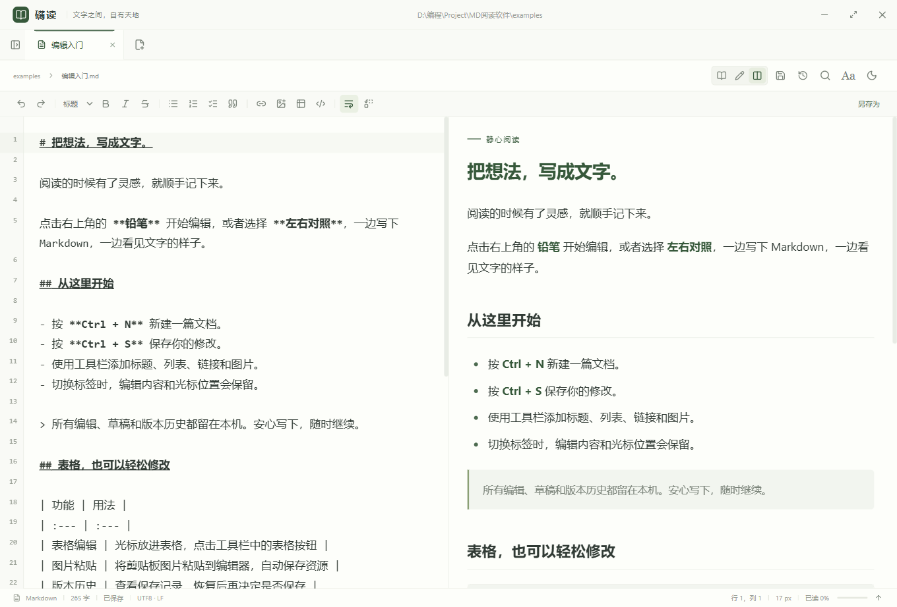

# 礴读

安静、清爽的 Windows Markdown 阅读与编辑软件。当前版本 **0.2.1**，面向 Windows 10/11 x64。



## 安装与开始

从 [GitHub Releases](https://github.com/1245505490/bodu-reader/releases/latest) 下载 Windows 安装包，或直接下载 [礴读 0.2.1 x64 安装包](https://github.com/1245505490/bodu-reader/releases/download/v0.2.1/Bodu-Setup-0.2.1-x64.exe)。同页提供 SHA-256 校验文件。

运行 `Bodu-Setup-0.2.1-x64.exe`，按中文向导选择安装位置。安装包包含完整运行环境，安装和使用不需要联网。程序目前未配置商业代码签名证书。

不安装也可直接运行 `release/win-unpacked/Bodu.exe`，请保留整个目录。开发时执行 `npm run dev`，界面修改会自动更新；主进程修改需重启。开发窗口支持 F12 / Ctrl+Shift+I 打开调试工具。

- 使用“打开文件”或拖入 `.md` / `.markdown` 文件开始阅读，可同时打开多篇。
- 使用文件夹按钮浏览文档树，支持子文件夹。左侧目录点击定位文章标题。
- `Ctrl+F` 在当前文章内搜索；`Ctrl+Shift+F` 搜索选定的文件夹。
- 右上角 **Aa** 调整字体、字号、正文宽度、行距和主题。偏好自动保存。
- 最近文件、标签和每篇文章的阅读位置会在重启后恢复。
- 安装后可从 Windows“打开方式”中选择礴读。不会更改现有默认阅读软件。

## 卸载

安装版提供正式卸载程序，三种入口均可使用：

- 在开始菜单点击 **卸载礴读**。
- 在安装目录双击 **卸载礴读.exe**。
- 在 Windows“设置 → 应用 → 已安装的应用”找到礴读并卸载。

打开后按卸载向导确认即可。卸载会移除程序、快捷方式和本软件的文件打开方式注册，默认保留用户数据目录中的设置、恢复草稿和版本历史。放在安装目录以外的 Markdown 文档和图片不受影响；个人资料请存放在自己的文档文件夹。

0.2.0 及更早的已安装版本可运行新安装包更新，从而获得中文卸载入口。旧版本也可通过 Windows 的应用列表卸载。

免安装版没有安装登记和卸载程序；关闭应用后可删除其运行目录。如果需要正式的卸载向导，请使用安装版。

## 编辑与保存

- 右上角切换阅读、编辑、左右对照；编辑器按需加载，普通阅读不加载编辑器代码。
- Ctrl+N 新建；Ctrl+S 保存；Ctrl+Shift+S 另存为。标签上的圆点表示未保存。
- 格式工具栏：标题、加粗、斜体、删除线、各类列表、引用、链接、图片、表格和代码块。
- 编辑器支持撤销/重做、自动换行和查找替换。Ctrl+F / Ctrl+H 打开编辑器查找替换面板，可区分大小写、逐项或全部替换。
- 编辑原文件时保留编码、BOM 和原有换行风格；新建及另存为采用 UTF-8。保存失败会保留编辑内容；关闭未保存标签或窗口时可保存、不保存或取消。
- 输入后约 350ms 将恢复草稿写入应用用户数据目录。草稿不覆盖原文；异常退出后重新运行会恢复。尚未写入的最后几百毫秒输入、磁盘故障或系统断电仍可能无法恢复。
- 外部修改通过活动窗口检查和约 5 秒轮询提示；保存时核验内容修订值，冲突可选择取消、载入磁盘、覆盖或另存为。另存为不允许覆盖另一个有未保存编辑的已打开文档。

## 图片、表格、历史与批量替换

- 编辑时粘贴图片或点击“插入图片”，资源会写到文档旁的“文档名.assets”文件夹，并插入相对链接；新文档需先保存。不会自动删除未引用图片。
- 光标位于 Markdown 表格内时点击表格按钮，可编辑该表格；其他位置可新增表格。网格支持单元格、行列增删和列对齐，最多 30 列、200 行正文。
- 右上角“版本历史”可查看最近 30 个版本，单篇最多 100 MB。恢复先载入编辑器，保存后才修改原文件。历史位于应用用户数据目录，不属于云端备份。
- 左侧切到“全文搜索”，点击其右侧替换按钮。批量替换必须先预览、勾选和再次确认；未保存文件和预览后变化的文件跳过，修改前自动记录版本。每篇展示一处示例，执行时替换全部匹配。超过预览限制需缩小范围。
- 将文档另存到其他目录时，正文中的相对链接保持原样；如需搬迁图片，请同时移动资源文件夹或调整链接。

## 渲染支持

支持 CommonMark 常用语法、表格、任务列表、代码高亮、相对路径图片、相对 Markdown 文档链接、`$...$` 行内公式、`$$...$$` / `\\[...\\]` 独立公式和 Mermaid 代码块。渲染依赖与数学字体全部本地打包。

默认进入阅读模式，编辑后由用户决定保存。不加载网络图片、不执行文档脚本，不提供账号、遥测、自动联网更新或云同步。用户点击的 HTTP/HTTPS 链接会在系统浏览器中打开。

本地图片可使用 PNG、JPEG、GIF、WebP、SVG、BMP、ICO、AVIF；图片需处于已打开的文件夹或当前文档所在目录范围内。跨目录图片可以先打开其公共父文件夹。远程图片显示离线提示。

## 范围与限制

- 单篇文档限制 20 MB；对特别大的文件当前仍采用整篇渲染。
- 全文搜索跳过隐藏目录、符号链接、依赖和构建目录，最多扫描 10,000 篇、返回 200 篇；跳过和截断情况显示在搜索结果中。每篇显示前五条匹配行。
- 文内搜索匹配正文和代码，忽略公式内部结构和图表标签，最多高亮 10,000 项。
- 自动识别 UTF-8、带 BOM 的 UTF-16 和常用 GB18030 编码；暂不支持 Word 式正文直接编辑、PDF 导出及插件。
- 阅读位置按本地路径保存；移动或重命名文件后需重新打开。

## 开发

需要 Node.js 22 或更高版本。项目默认使用 PowerShell（pwsh）执行命令。

```powershell
npm ci
npm run dev
```

```powershell
npm run build     # TypeScript 检查与生产构建
npm test          # 编码、路径与文件搜索测试
npm run test:e2e  # Electron 桌面交互测试
npm run test:editing # 编辑、保存、冲突、草稿与高级工具测试
npm run test:uninstall # 隔离安装和卸载验证；先运行 npm run dist
npm run dist      # 生成 Windows x64 NSIS 完整离线安装包
```

桌面测试默认生成公开的中文长文和功能示例，不依赖个人文档。可通过 `BODU_SAMPLE` 环境变量额外指定本地文档，验证启动并保存本地截图后，继续执行公共示例测试。测试报告和截图位于 `test-results/`，应用数据使用隔离目录。

私人文档、测试输出、恢复草稿、依赖、构建产物和本地凭据均不纳入版本控制；请勿将个人文档或密钥放入源码目录。开发和首次构建需要下载依赖，生成的软件可离线安装和使用。

项目结构：`src/` 为界面与渲染；`src/editing/` 为按需加载的编辑器、编辑状态与工具对话框；`electron/` 为文件读写、持久化与桌面桥接；`build/` 为图标与安装脚本；`tests/` 为验证；`docs/` 记录产品约定和验证结果。
